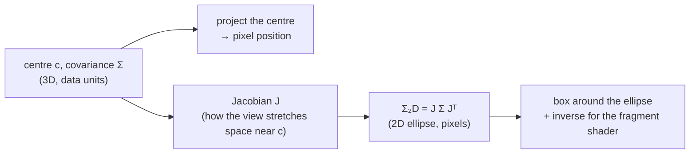
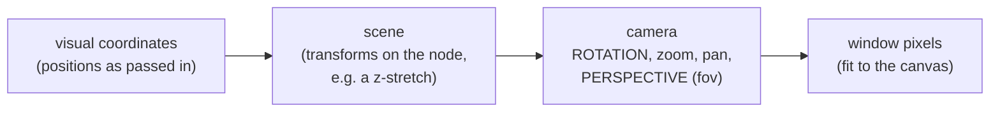

# Rendering 3D Gaussian splats with a vertex and a fragment shader

This note explains, one piece at a time, the maths in the `GaussianSplat`
visual written by Ashley Anderson for vispy, in vispy/vispy#2761
(https://github.com/vispy/vispy/pull/2761). All code excerpts are from that
pull request (commit `b0deb0a4`).

## The big picture

Each splat is a 3D Gaussian: a centre $\mathbf{c}$ and a $3\times3$ covariance
$\Sigma$ that sets its size and orientation. To draw it, the vertex shader has
to answer two questions:

1. **Where** does the centre land on screen? (a point)
2. **What shape** does the 3D Gaussian make on screen? (a 2D ellipse, in pixels)



Question 1 is easy: project one point. Question 2 needs the **Jacobian**, which
is the first piece of maths in the shader.

## Part 0: where the rotation and perspective come from

There is no rotation matrix anywhere in the shader, and no perspective maths
either. Both are hidden in one line, a placeholder that vispy fills in:

```glsl
vec2 project(vec3 p) {
    vec4 fb = $visual_to_framebuffer(vec4(p, 1.0));
    return fb.xy / fb.w;
}
```

The `$` marks a spot in vispy's shader templates. When vispy builds the shader,
it pastes in the GLSL for the whole chain of transforms from the splat's own
coordinates to pixels in the window:



The camera step is the `TurntableCamera` you drag with the mouse, so the
rotation you choose is part of this chain. Its `fov` sets the perspective:
for example `fov=45` gives perspective, and `fov=0` (napari's default) gives none.

In maths, the chain is one $4\times4$ matrix $M$ acting on the point in
homogeneous coordinates (the point plus a 1), followed by a division by the
last coordinate $w$:

$$
\begin{bmatrix} X \\ Y \\ Z \\ w \end{bmatrix} = M \begin{bmatrix} x \\ y \\ z \\ 1 \end{bmatrix},
\qquad
f(\mathbf{x}) = \left( \frac{X}{w},\ \frac{Y}{w} \right)
\qquad\text{with}\quad
M = M_{\text{window}}\, M_{\text{perspective}}\, M_{\text{rotation, zoom, pan}}\, M_{\text{node}}
$$

- The rotation is inside $M$.
- With perspective, $w$ grows with distance from the camera, so dividing by $w$
  makes far things smaller. Without perspective, $w = 1$ and the division does
  nothing.

`project(p)` is exactly this $f$: `$visual_to_framebuffer` multiplies by $M$,
and `fb.xy / fb.w` is the division by $w$. The splat's centre goes through it
once:

```glsl
vec4 fb_center = $visual_to_framebuffer(vec4(a_center, 1.0));
vec2 c = fb_center.xy / fb_center.w;     // the centre in pixels: f(c)
```

Everything after this (the Jacobian in Part 1, the 2D ellipse in Part 2)
calls `project()`, so the rotation and perspective are carried along without
ever being written out.

## Part 1: the Jacobian $J$

```glsl
// finite-difference Jacobian J (2x3)
// get visual-space displacement -> pixels for each dim
vec2 jx = (project(a_center + vec3(u_eps, 0.0, 0.0)) - c) / u_eps;
vec2 jy = (project(a_center + vec3(0.0, u_eps, 0.0)) - c) / u_eps;
vec2 jz = (project(a_center + vec3(0.0, 0.0, u_eps)) - c) / u_eps;
```

### What it is

Write the camera's projection as a function $f$ that takes a 3D point and gives
its pixel position on screen:

$$
f : \mathbb{R}^3 \to \mathbb{R}^2, \qquad f(\mathbf{x}) = (\text{pixel } x,\ \text{pixel } y)
$$

The Jacobian of $f$ at the centre is a $2\times3$ table of slopes: how far the
pixel position moves for a small step along each data axis.

$$
J =
\begin{bmatrix}
\dfrac{\partial f_x}{\partial x} & \dfrac{\partial f_x}{\partial y} & \dfrac{\partial f_x}{\partial z} \\[2ex]
\dfrac{\partial f_y}{\partial x} & \dfrac{\partial f_y}{\partial y} & \dfrac{\partial f_y}{\partial z}
\end{bmatrix}
= \begin{bmatrix} \mathbf{j}_x & \mathbf{j}_y & \mathbf{j}_z \end{bmatrix}
$$

Each column is one of the shader's three variables: `jx` is "pixels moved per
unit step in data $x$", and the same for `jy` and `jz`.

### How the shader gets it: nudge and measure

The shader can't write $f$ down as a formula (vispy's transform can include
perspective, scaling, anything), so it measures the slopes. It projects the
centre, then the centre nudged a tiny distance $\varepsilon$ (`u_eps`) along
each axis, and divides the difference by $\varepsilon$:

$$
\mathbf{j}_x \approx \frac{f(\mathbf{c} + \varepsilon\,\hat{\mathbf{x}}) - f(\mathbf{c})}{\varepsilon}
$$

```glsl
vec2 c = fb_center.xy / fb_center.w;                                   // f(c)
vec2 jx = (project(a_center + vec3(u_eps, 0.0, 0.0)) - c) / u_eps;     // j_x
```

```
   data space (3D)                          screen (pixels)

        c + ε·ẑ                                   ● f(c + ε·ẑ)
         ●                                       ╱
         │                                      ╱  jz
         │                             f(c) ●──────● f(c + ε·x̂)
         ● c ─────● c + ε·x̂                  │   jx
        ╱                                     │ jy
       ● c + ε·ŷ                              ● f(c + ε·ŷ)
```

This is a **finite difference**: the slope from two nearby points, the same
idea as estimating a speed from two positions a moment apart.

### Why it's needed: the shape, not the position

Projecting the centre tells you **where** the splat goes. It says nothing about
**how big and how tilted** it looks. For that you need to know how the view
stretches space near the centre, and that is exactly what $J$ holds.

A splat is small, so near its centre the projection is almost a straight-line
(linear) map, and $J$ is that map:

$$
f(\mathbf{c} + \mathbf{d}) \approx f(\mathbf{c}) + J\,\mathbf{d} \qquad \text{for a small offset } \mathbf{d}
$$

So everything inside the splat moves on screen by $J\,\mathbf{d}$, which is
what lets the next step turn the 3D covariance into a 2D one.

### Only the centre, no sigma yet

$J$ depends only on **where** the splat is and on the camera, not on its
shape. Two splats at the same place get the same $J$, whatever their sizes. The
shape ($\Sigma$) comes in at the next step.

### Without perspective

With no perspective, the projection is just "rotate, then keep $x$ and $y$,
then scale to pixels". That's already linear, so $J$ is exact and needs no
nudging:

$$
J = s \begin{bmatrix} R_{00} & R_{01} & R_{02} \\ R_{10} & R_{11} & R_{12} \end{bmatrix}
\qquad (s = \text{pixels per unit} \times \text{zoom})
$$

the top two rows of the rotation matrix. Measuring $J$ instead makes the shader
work with perspective too, where far things shrink and $J$ is different for
every splat.

## Part 2: from the 3D covariance to the 2D ellipse

Five steps, each shown as maths and as the shader lines that do it.

### Step 1: rebuild $\Sigma$ from 6 numbers

A covariance matrix is symmetric (the value at row 0, column 1 equals the one
at row 1, column 0), so only 6 of its 9 numbers are stored. The `mat3` line
puts them back:

$$
\Sigma =
\begin{bmatrix}
\Sigma_{00} & \Sigma_{01} & \Sigma_{02} \\
\Sigma_{01} & \Sigma_{11} & \Sigma_{12} \\
\Sigma_{02} & \Sigma_{12} & \Sigma_{22}
\end{bmatrix}
$$

The diagonal holds the variances ($\sigma^2$ along $x$, $y$, $z$); the other
three numbers describe how tilted the ellipsoid is.

| # | variable | meaning | matrix position |
|---|---|---|---|
| 1 | `a_cov_a.x` | variance in $x$ ($\sigma_x^2$) | $\Sigma_{00}$ |
| 2 | `a_cov_a.y` | covariance $x$–$y$ | $\Sigma_{01}$ (and $\Sigma_{10}$) |
| 3 | `a_cov_a.z` | covariance $x$–$z$ | $\Sigma_{02}$ (and $\Sigma_{20}$) |
| 4 | `a_cov_b.x` | variance in $y$ ($\sigma_y^2$) | $\Sigma_{11}$ |
| 5 | `a_cov_b.y` | covariance $y$–$z$ | $\Sigma_{12}$ (and $\Sigma_{21}$) |
| 6 | `a_cov_b.z` | variance in $z$ ($\sigma_z^2$) | $\Sigma_{22}$ |

For an axis-aligned splat (SMLM), entries 2, 3 and 5 are 0.

```glsl
mat3 sigma = mat3(
    a_cov_a.x, a_cov_a.y, a_cov_a.z,    // Σ00 Σ01 Σ02
    a_cov_a.y, a_cov_b.x, a_cov_b.y,    // Σ01 Σ11 Σ12
    a_cov_a.z, a_cov_b.y, a_cov_b.z     // Σ02 Σ12 Σ22
);
```

### Step 2: project it, $\Sigma_{2D} = J\,\Sigma\,J^\top$

Part 1 showed that near the centre, an offset $\mathbf{d}$ inside the splat
moves on screen by $J\,\mathbf{d}$. If the 3D offsets have covariance $\Sigma$,
the screen offsets $J\,\mathbf{d}$ have covariance

$$
\Sigma_{2D} = J\,\Sigma\,J^\top
=
\begin{bmatrix} a & b \\ b & c \end{bmatrix}
\qquad (2\times2,\ \text{in pixels}^2)
$$

the same "multiply on both sides" pattern used to rotate a covariance
($R\,\Sigma\,R^\top$). Here $a$ is the spread along screen $x$, $c$ the spread
along screen $y$, and $b$ the tilt.

**$J$ already includes the rotation.** With no perspective,
$J = s\,P\,R$, where $R$ is the view rotation, $P$ keeps $x$ and $y$ (drops
$z$), and $s$ is pixels per unit times zoom. Then

$$
J\,\Sigma\,J^\top = s^2\, P\,(R\,\Sigma\,R^\top)\,P^\top
$$

which is "rotate the covariance, keep the top-left $2\times2$, scale to
pixels".

**Why rows and dot products?** The shader computes the three numbers one at a
time, using the rows $\mathbf{r}_0$ and $\mathbf{r}_1$ of $J$:

$$
\mathbf{r}_0 = \begin{bmatrix} j_{x,0} & j_{y,0} & j_{z,0} \end{bmatrix}, \qquad
\mathbf{r}_1 = \begin{bmatrix} j_{x,1} & j_{y,1} & j_{z,1} \end{bmatrix}
$$

$$
a = \mathbf{r}_0^\top \Sigma\, \mathbf{r}_0, \qquad
b = \mathbf{r}_0^\top \Sigma\, \mathbf{r}_1, \qquad
c = \mathbf{r}_1^\top \Sigma\, \mathbf{r}_1
$$

```glsl
vec3 r0 = vec3(jx.x, jy.x, jz.x);       // row 0 of J (screen x)
vec3 r1 = vec3(jx.y, jy.y, jz.y);       // row 1 of J (screen y)
vec3 sr0 = sigma * r0;                  // Σ r0
vec3 sr1 = sigma * r1;                  // Σ r1
float ca0 = dot(r0, sr0);               // a = r0ᵀ Σ r0
float cb  = dot(r0, sr1);               // b = r0ᵀ Σ r1
float cc0 = dot(r1, sr1);               // c = r1ᵀ Σ r1
```

The older GLSL that vispy targets has no $2\times3$ matrix type, so the matrix
product is written out this way.

### Step 3: a minimum size (dilation)

$$
a \leftarrow a + 0.3, \qquad c \leftarrow c + 0.3 \quad (\text{pixels}^2)
$$

```glsl
const float c_dilation = 0.3;           // (declared near the top)
float ca = ca0 + c_dilation;
float cc = cc0 + c_dilation;
```

This adds a little width on each axis, so no splat ends up thinner than about
half a pixel (otherwise tiny splats flicker or vanish).

### Step 4: skip broken ellipses

The determinant $ac - b^2$ is (roughly) the ellipse's area squared. If it is 0
or negative, the "ellipse" is flat or not a real ellipse, and can't be
inverted. A vertex shader can't simply skip a splat, so it moves the corner to
$(2, 2, 2)$, outside the visible $-1 \dots 1$ box, and the GPU discards it.

$$
\det \Sigma_{2D} = ac - b^2
$$

```glsl
float det = ca * cc - cb * cb;
if (det <= 0.0) {
    gl_Position = vec4(2.0, 2.0, 2.0, 1.0);   // off screen: nothing drawn
    return;
}
```

### Step 5: the inverse, sent as `v_conic`

The Gaussian's brightness at a pixel offset $(x, y)$ from the centre is

$$
\exp\!\left(-\tfrac12 \begin{bmatrix} x & y \end{bmatrix} \Sigma_{2D}^{-1} \begin{bmatrix} x \\ y \end{bmatrix}\right)
= \exp\!\left(-\tfrac12\,(A x^2 + 2B\,xy + C y^2)\right)
$$

the 2D version of $\exp(-\tfrac12\, x^2/\sigma^2)$, where dividing by
$\sigma^2$ becomes multiplying by the inverse. For a $2\times2$ matrix the
inverse is quick: swap the diagonal, negate the off-diagonal, divide by the
determinant:

$$
\Sigma_{2D}^{-1} = \frac{1}{ac - b^2}\begin{bmatrix} c & -b \\ -b & a \end{bmatrix}
= \begin{bmatrix} A & B \\ B & C \end{bmatrix}
$$

```glsl
v_conic = vec3(cc, -cb, ca) / det;      // (A, B, C) = (c, -b, a) / det
```

It is computed once per splat here and used by every pixel of the splat in the
fragment shader.

The name: the curves where $A x^2 + 2B\,xy + C y^2$ is constant are ellipses,
which belong to the family of curves called conic sections.

## Part 3: the box around the ellipse

The fragment shader only runs for pixels inside the shape that is drawn, so
each splat needs a drawing area that holds its ellipse. The visual draws one
small rectangle (a "quad") per splat, turned to line up with the ellipse, so very few
pixels are wasted:

```
             e2 (short axis)
              ↑
    (-1,+1) ●─┼──────────────● (+1,+1)        corners: a_quad = (±1, ±1)
            │ │   ⬭ ellipse  │
            │ ●──────────────┼──→ e1 (long axis)
            │                │
    (-1,-1) ●────────────────● (+1,-1)
            ←── 2 · r_major ──→
```

What is shared between splats is a **template**: the 4 corner labels
$(-1,-1)$, $(+1,-1)$, $(-1,+1)$, $(+1,+1)$, uploaded once as `a_quad` and reused
for every splat (instanced drawing). The vertex shader runs 4 times per splat,
and each run turns one template corner into that splat's real corner, using the
splat's own centre, size, tilt and projection. So "top-right" lands somewhere
different for every splat.

To place the corners, the shader needs the ellipse's two axes: their
**directions** and their **lengths**. Those are the eigenvectors and
eigenvalues of $\Sigma_{2D}$.

### Step 1: the axis lengths (eigenvalues)

For the $2\times2$ matrix $\begin{bmatrix} a & b \\ b & c \end{bmatrix}$, the
two eigenvalues have a closed formula, using the trace $a + c$ and the
determinant $ac - b^2$:

$$
\lambda_{1,2} = \frac{a + c}{2} \pm \sqrt{\left(\frac{a + c}{2}\right)^2 - (ac - b^2)}
$$

$\lambda_1$ (the larger) is the variance along the ellipse's long axis and
$\lambda_2$ along its short axis, in pixels².

```glsl
float tr = ca + cc;                                   // trace: a + c
float disc = sqrt(max(tr * tr * 0.25 - det, 0.0));    // the square root part
float l1 = tr * 0.5 + disc;                           // λ1 (long axis)
float l2 = max(tr * 0.5 - disc, 0.0);                 // λ2 (short axis)
```

The `max(..., 0.0)` calls guard against tiny negative numbers from rounding.

### Step 2: the axis directions (eigenvectors)

An eigenvector $\mathbf{e}$ for $\lambda_1$ satisfies
$(\Sigma_{2D} - \lambda_1 I)\,\mathbf{e} = 0$. Its second row reads
$b\,e_x + (c - \lambda_1)\,e_y = 0$, which holds for

$$
\mathbf{e}_1 \propto \begin{bmatrix} \lambda_1 - c \\ b \end{bmatrix},
\qquad
\mathbf{e}_2 = \begin{bmatrix} -e_{1,y} \\ e_{1,x} \end{bmatrix} \ \ (\mathbf{e}_1 \text{ turned } 90°)
$$

When $b = 0$ the ellipse isn't tilted, the formula gives a zero vector, and the
axes are simply screen $x$ and $y$, so the shader picks whichever is longer.

```glsl
vec2 e1;
if (abs(cb) < 1e-9) {
    e1 = (ca >= cc) ? vec2(1.0, 0.0) : vec2(0.0, 1.0);    // no tilt
} else {
    e1 = normalize(vec2(l1 - cc, cb));                    // e1 ∝ (λ1 - c, b)
}
vec2 e2 = vec2(-e1.y, e1.x);                              // e1 turned 90°
```

### Step 3: how far out to go (3 sigma)

The standard deviation along each axis is $\sqrt{\lambda}$. A Gaussian is
practically invisible beyond $3\sigma$ (about 1% of its peak), so the box goes
out $3\sigma$ along each axis:

$$
r_{\text{major}} = 3\sqrt{\lambda_1}, \qquad r_{\text{minor}} = 3\sqrt{\lambda_2}
$$

```glsl
const float c_cutoff = 3.0;                  // (declared near the top)
float r_major = c_cutoff * sqrt(l1);
float r_minor = c_cutoff * sqrt(l2);
```

### Step 4: place this corner

Each corner is the centre plus $\pm r_{\text{major}}$ along $\mathbf{e}_1$ and
$\pm r_{\text{minor}}$ along $\mathbf{e}_2$, with the signs taken from `a_quad`:

$$
\text{offset} = q_x\, r_{\text{major}}\, \mathbf{e}_1 + q_y\, r_{\text{minor}}\, \mathbf{e}_2,
\qquad (q_x, q_y) = \texttt{a\_quad} \in \{\pm1\}^2
$$

```glsl
vec2 offset = a_quad.x * r_major * e1 + a_quad.y * r_minor * e2;  // pixels
```

This offset is in pixels, measured from the centre $f(\mathbf{c})$. Part 4
adds it to the centre to get the corner's final position.

### An alternative: point sprites

A simpler option is a square point sprite (`gl_PointSize`), which can't be
turned, sized by the larger spread: $\text{size} = 6\sqrt{\max(a, c)}$. That
needs no eigenvectors, but wastes pixels on long, thin, tilted splats, and GPUs
limit how large a point sprite can be. A turned rectangle fits tightly and has
no size limit.

## Part 4: the corner's final position, and passing values on

The last lines of the vertex shader hand values to the fragment shader, adjust
the opacity in one special case, and put the corner on screen.

### Step 1: values for the fragment shader

```glsl
v_offset = offset;      // this corner's offset from the centre, in pixels
v_color = a_color;      // the splat's colour and opacity
                        // (v_conic was set in Part 2)
```

The GPU blends `v_offset` across the rectangle between its 4 corners, so every
pixel inside receives its own offset from the splat's centre. That offset is
the $(x, y)$ the fragment shader puts into the Gaussian.

$$
\text{corner offsets } \pm r_{\text{major}}\,\mathbf{e}_1 \pm r_{\text{minor}}\,\mathbf{e}_2
\ \ \xrightarrow{\ \text{GPU blends}\ }\ \
\text{each pixel's offset } (x, y)
$$

### Step 2: keep the brightness right after the dilation (optional)

Part 2 widened every ellipse a little ($+0.3$ pixels² on each axis). A wider
Gaussian with the same peak carries more total weight. For scenes trained to
expect that widening (the `antialias` option, Mip-Splatting style; Postshot
marks this in the file), the peak opacity is lowered so the total stays the
same.

The area of an ellipse is proportional to $\sqrt{\det}$, so the opacity is
scaled by the ratio of the areas before and after widening:

$$
\alpha \leftarrow \alpha \sqrt{\frac{\det \Sigma_{2D}^{\text{before}}}{\det \Sigma_{2D}^{\text{after}}}}
= \alpha \sqrt{\frac{a_0 c_0 - b^2}{a c - b^2}}
$$

```glsl
if (u_antialias > 0.5) {
    float det0 = max(ca0 * cc0 - cb * cb, 0.0);   // before widening
    v_color.a *= sqrt(det0 / det);                // det = after widening
}
```

### Step 3: put the corner on screen

The corner is the centre plus the offset. One detail comes from perspective:
the GPU always divides the final position by $w$ (Part 0). `fb_center` is the
centre **before** that division, so adding the offset directly would get it
divided by $w$ too, and shrunk. Multiplying the offset by $w$ first cancels the
division:

$$
\frac{X + w\,o_x}{w} = \frac{X}{w} + o_x
\qquad\text{(and the same for } y\text{)}
$$

so the corner lands exactly `offset` pixels from the centre. Without
perspective $w = 1$, and this changes nothing.

```glsl
vec4 fb = fb_center;                        // the centre, before the division by w
fb.xy += offset * fb.w;                     // add the offset, scaled by w
gl_Position = $framebuffer_to_render(fb);   // pixels -> the GPU's -1..1 range
```

`$framebuffer_to_render` is another vispy placeholder, the last step of the
chain from Part 0: it converts window pixels into the $-1 \dots 1$ range the
GPU expects in `gl_Position`. That ends the vertex shader.

## Part 5: the fragment shader, painting the Gaussian

The fragment shader runs once for every pixel inside every splat's rectangle.
It receives that pixel's offset from the centre (`v_offset`, blended in Part 4),
the ellipse (`v_conic`, Part 2) and the colour (`v_color`). All the hard work
was done in the vertex shader; this part is short.

### Step 1: the Gaussian at this pixel

$$
\text{power} = -\tfrac12 \left(A\,x^2 + 2B\,xy + C\,y^2\right),
\qquad
\text{weight} = e^{\,\text{power}}
$$

with $(x, y)$ the pixel's offset and $(A, B, C)$ the inverse of $\Sigma_{2D}$.

```glsl
vec2 o = v_offset;                               // (x, y)
float power = -0.5 * (
    v_conic.x * o.x * o.x                        // A x²
    + 2.0 * v_conic.y * o.x * o.y                // 2B xy
    + v_conic.z * o.y * o.y                      // C y²
);
float alpha = v_color.a * exp(power);            // opacity × weight
```

The splat's opacity is multiplied by the Gaussian's weight: full opacity at the
centre, fading towards the edge of the rectangle.

### Step 2: skip pixels that don't matter

```glsl
if (power > 0.0)
    discard;                 // can't happen for a real ellipse; a safety check
if (alpha < 1.0 / 255.0)
    discard;                 // too faint to change an 8-bit pixel
```

`discard` means "draw nothing for this pixel". The second check saves the GPU
from blending thousands of invisible contributions near the corners.

### Step 3: the colour, premultiplied

$$
\text{output} = \left(\alpha\,r,\ \alpha\,g,\ \alpha\,b,\ \alpha\right)
$$

```glsl
gl_FragColor = vec4(v_color.rgb * alpha, alpha);
```

"Premultiplied" means the colour has already been multiplied by its opacity,
which is the form the blending step below expects.

### Step 4: blending, set in Python

Combining one splat's pixel with what is already on screen is not done in the
shader but by the GPU's blending, configured in Python:

```python
self.set_gl_state(
    depth_test=False,
    cull_face=False,
    blend=True,
    blend_func=("one", "one_minus_src_alpha"),
)
```

That is the "over" rule: the new splat covers what is behind it in proportion
to its opacity.

$$
\mathbf{C}_{\text{screen}} \leftarrow \underbrace{\alpha\,\mathbf{c}}_{\text{"one"} \times \text{new}}
+ \underbrace{(1 - \alpha)}_{\text{"one\_minus\_src\_alpha"}}\,\mathbf{C}_{\text{screen}}
$$

For "over" to look right, splats must be drawn **back to front**, so the
visual sorts them by depth on the CPU whenever the view turns (its `_sort`
method). This suits 3D Gaussian Splatting, where splats describe surfaces and
front ones should hide back ones.

### An alternative: additive blending for density data

For data where the splats describe density rather than surfaces, such as
single-molecule localization microscopy (SMLM), the "over" rule hides most of
the structure behind the front layers. Adding every splat instead
(`blend_func=("one", "one")`) makes overlapping splats sum up, so brightness
shows how many there are, and no sorting is needed because a sum doesn't depend
on order:

$$
\mathbf{C}_{\text{screen}} \leftarrow \alpha\,\mathbf{c} + \mathbf{C}_{\text{screen}}
$$

The rest of the shader stays the same.
